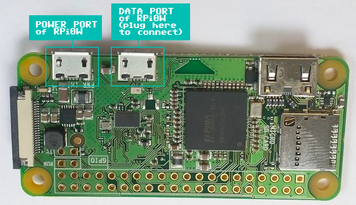

# Pwnagotchi

Thanks for ordering your Pwnagotchi from PhreakBoutique! It's a little AI that lives on a Raspberry Pi, watches the Wi-Fi around it, and gets happier the more WPA handshakes it collects. Ours run the **[jayofelony fork](https://github.com/jayofelony/pwnagotchi)**, the actively maintained version of the project.

## First boot

1. Power it from a good supply: **3 A or better**. Weak phone chargers are the #1 cause of SD card corruption.
2. Give it **1–2 minutes**. The first boot after shipping can take a little longer.
3. Watch the face appear. :smile:

!!! note "The screen looks glitchy at first. That's normal."
    E-ink screens need a few refresh cycles to clear up, so ghosting and artifacts right after power-on are expected. In **MANU** (manual) mode the screen barely refreshes, while in **AUTO** mode it updates regularly.

### What the faces mean

Its mood reflects what it's doing: bored when nothing's around, excited when it finds new networks, sad when it can't get handshakes. The original project's [intro page](https://pwnagotchi.ai/intro/) is still the best explanation of the faces and modes.

## Connect to it

Connect the Pwnagotchi to your computer with a USB **data** cable. Many cables only charge. On a Pi Zero, use the micro-USB port **closest to the mini-HDMI port**, labeled **USB** (not **PWR**). Your computer sees it as a USB network adapter.

<figure markdown>
  { width="560" }
  <figcaption>Plug into the <strong>data port</strong>. It powers the Pwnagotchi and connects it to your computer.</figcaption>
</figure>

=== "Windows"

    1. If you've used a Pwnagotchi before and have the old **RNDIS** driver installed, uninstall it first and reboot your PC.
    2. Download and run the USB gadget driver installer: **[rpi-usb-gadget-driver-setup.exe](https://raw.githubusercontent.com/wiki/jayofelony/pwnagotchi/rpi-usb-gadget-driver-setup.exe)**
    3. Plug in your Pwnagotchi and give it a minute or two to boot.

=== "macOS"

    1. Plug in your Pwnagotchi and give it a minute or two to boot.
    2. Open **System Settings → Network**. Using the **⋯** menu, choose **Set Service Order** and drag **Wi-Fi** above the **Raspberry Pi USB Gadget** service. If you still have an old RNDIS service listed, you can safely remove it.
    3. *Optional:* to give your Pwnagotchi internet access through your Mac, turn on **Internet Sharing** (System Settings → General → Sharing) and share your connection to the USB Gadget.

=== "Linux"

    Plug in your Pwnagotchi and give it a minute or two to boot. It connects automatically about 10 seconds after booting finishes.

Then open a terminal (on Windows, Command Prompt or PowerShell) and SSH in:

```bash
ssh pi@pwnagotchi.local
```

Type `yes` to accept the security prompt the first time, then enter the default password: **`raspberry`**. Change it right away with `passwd`.

!!! danger "Don't run `apt-get upgrade`"
    Upgrading the system packages breaks Pwnagotchi, and the only fix is reflashing the SD card and starting over. Firmware updates come as new images from the [jayofelony releases](https://github.com/jayofelony/pwnagotchi/releases).

### The web UI

While connected, open **[http://pwnagotchi.local:8080](http://pwnagotchi.local:8080)** in your browser to see its face and stats. The default login is `changeme` / `changeme`, and you should change it in your config (see below).

## Make it yours

The config file is `/etc/pwnagotchi/config.toml`. Edit it with:

```bash
sudo nano /etc/pwnagotchi/config.toml
```

The fork also includes a shortcut: just type `config`.

```toml
main.name = "yourname"                  # give it a name
main.whitelist = [ "MyHomeWiFi" ]       # networks it should leave alone

ui.web.username = "pick-a-username"
ui.web.password = "pick-a-strong-password"
```

Save, then restart it:

```bash
sudo systemctl restart pwnagotchi
```

!!! tip "Bluetooth tethering for mobile fun"
    Tether your Pwnagotchi to your phone so you can check on it and use the web UI on the go. The setup changes between releases, so follow the current instructions in the [fork's wiki](https://github.com/jayofelony/pwnagotchi/wiki).

The [jayofelony wiki](https://github.com/jayofelony/pwnagotchi/wiki) covers configuration, plugins, and customizing faces and display layouts.

## Take care of it

- **Shut it down properly** before unplugging: `sudo shutdown -h now`, then wait for the green light to stop blinking. Pulling the power while it's writing is the most common way to corrupt the SD card.
- **Don't open the case.** The internals are fragile, and **removing the unit from its case voids support eligibility**. If you really must, remove the SD card first using soft-tipped tweezers and very little pressure, then gently lift the hardware out of the case. Never force it.

## Troubleshooting

??? question "It won't boot, or it's stuck on a blank or frozen screen"
    The SD card has most likely become corrupted, usually from a weak power supply or unplugging without shutting down. The fix is to flash a fresh image:

    1. Download the latest image for your board from the [jayofelony releases](https://github.com/jayofelony/pwnagotchi/releases).
    2. Flash it to the SD card with [Raspberry Pi Imager](https://www.raspberrypi.com/software/) or balenaEtcher.
    3. Follow the fork's [installation guide](https://github.com/jayofelony/pwnagotchi/wiki) to set up your config again.

    Then use a 3 A power supply to keep it from happening again. Our [tutorials blog](https://phreakboutique.com/blogs/tutorials) has our latest step-by-step flashing guidance.

??? question "My computer doesn't see it over USB"
    - Make sure you're using the **data** port and a **data** cable. Many cables only charge.
    - On Windows, make sure you installed the [USB gadget driver](#connect-to-it) and removed any old RNDIS driver.
    - On macOS, check that the service order puts Wi-Fi above the USB Gadget.
    - Give it the full 1–2 minutes to boot before trying.

## Need help?

[Get in touch](../support.md). We're always ready to help. We hope you enjoy your new Pwnagotchi, and thank you again: orders like yours make DC207 a reality and help our Maine community thrive. Happy hacking!
