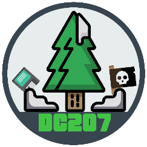

# Get help

{ .pb-dc207 }

We want you to have a great experience with your gear. If you're stuck on setup, troubleshooting, or something more advanced, we're a quick email away.

**Email:** [support@phreakboutique.com](mailto:support@phreakboutique.com) 
**Shop:** [phreakboutique.com](https://phreakboutique.com/) 
**Tutorials:** [phreakboutique.com/blogs/tutorials](https://phreakboutique.com/blogs/tutorials)

## When you email us

Include these so we can help faster:

- Which product you have, and roughly when you ordered it
- Your operating system (Windows 11, macOS, Ubuntu, …)
- What you tried and what happened, with any error messages (screenshots are great)

## Community

Each project has an active open-source community, and most link to a Discord server from their GitHub page:

| Product | Upstream project |
|---|---|
| ESP32 Marauder | [Fr4nkFletcher/ESP32-Marauder-Cheap-Yellow-Display](https://github.com/Fr4nkFletcher/ESP32-Marauder-Cheap-Yellow-Display) and [justcallmekoko/ESP32Marauder](https://github.com/justcallmekoko/ESP32Marauder) |
| Pwnagotchi | [jayofelony/pwnagotchi](https://github.com/jayofelony/pwnagotchi) |
| Proxmark3 | [RfidResearchGroup/proxmark3](https://github.com/RfidResearchGroup/proxmark3) (Iceman) |
| Evil USB Cable / PwnPixel | [CedArctic/DigiSpark-Scripts](https://github.com/CedArctic/DigiSpark-Scripts) (example payloads) |

## Where your money goes

PhreakBoutique supports DC207, Maine's DEF CON group. Your purchase helps fund scholarships and free educational events, and keeps our community open and free from corporate sponsorship or influence. Thank you for being part of it!

## Found a mistake in these docs?

Every page has an edit button (the pencil icon) that links to the source on GitHub. Pull requests are welcome, or just [email us](mailto:support@phreakboutique.com).
